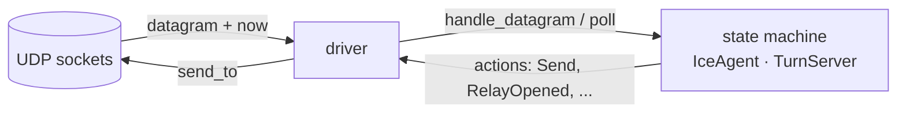
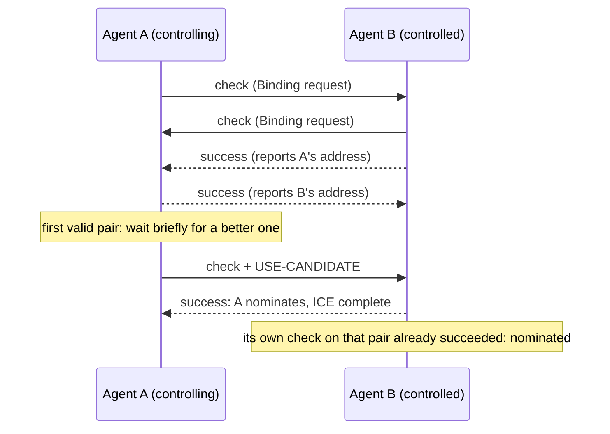

# Architecture

## Process model

Each protocol adapter is designed to run as its own supervised OS process. The
core owns the message bus between them (length-prefixed frames, with a hard cap
on frame size so a corrupt length cannot force a huge allocation) and a module
registry for health and supervision. A failure in one adapter is contained to
its process.

Today the adapters exist as separate crates in a single workspace. Live IPC
between two running processes has not been exercised yet.

| Crate | Responsibility |
|---|---|
| `core` | IPC framing, link-state routing, capacity maths, tracing |
| `voip-sip` | SIP signalling, RTP/SRTP media plane, call-quality scoring |
| `nat-traversal` | STUN, TURN, ICE |

## Sans-IO state machines

The two most involved components — the ICE agent and the TURN server — are
written so that they **do no I/O and read no clock**:

Every input carries the current time, and every output is a value describing
what to send. Consequences:

- **Timers are tested exactly.** The STUN retransmission schedule is asserted to
  the millisecond (sends at 0, 0.5, 1.5, 3.5, 7.5, 15.5 and 31.5 s; failure at
  39.5 s) without waiting for any of it.
- **Whole negotiations run in memory.** Two agents, a virtual network and NAT
  models are wired together in a test, with loss, latency and role conflicts
  injected deterministically.
- **The driver is small.** `ice::run_agent` is the only code that touches
  sockets and the wall clock. A finished agent keeps answering for a linger
  period, because the controlled side completes only after the controlling side
  answers its check.

The ICE agent has a driver; the TURN server and client are sans-IO too, with their drivers pending.

## NAT traversal

STUN discovers an endpoint's public address; TURN supplies a relayed address when
no direct path exists; ICE gathers candidates, probes pairs, and nominates the
best working one.

Behaviours worth knowing:

- **Triggered checks** make hole-punching work through address-restricted NATs:
  each side's first check is dropped, but sending it opens the permission the
  other side's check needs.
- **Peer-reflexive candidates** are learned from checks that arrive from an
  address nobody advertised (a symmetric NAT's per-destination mapping).
- **Regular nomination with a short delay.** The highest-priority pair is often
  a dead private address; waiting for it to time out would stall a working path
  for the full transaction timeout (about 40 s with RFC defaults).

## Security model

| Layer | Mechanism |
|---|---|
| TURN control messages | Long-term credentials; success responses are signed so a client can reject a forged one |
| ICE connectivity checks | Short-term credentials (the ICE password); FINGERPRINT is only a checksum, never trusted for security |
| TURN data path | No per-packet authentication, by design of the protocol, so the **permission table is the only barrier** between a relay and an open proxy |
| Transaction IDs | OS CSPRNG: an unsigned error response is guarded by nothing else |

Rules the code holds to:

- A request that fails authentication creates nothing — no pair, candidate,
  allocation or permission.
- Only an *authenticated* role-conflict error may flip an agent's role.
- State tied to an allocation (permissions, channel bindings) dies with it.
- A response that fails validation is discarded and the transaction continues,
  so forging one cannot end a check.

## Design decisions

| Decision | Why | Cost |
|---|---|---|
| Sans-IO state machines | Deterministic, exact timer tests, in-memory simulation | A thin driver per component |
| Regular nomination with a delay | Aggressive nomination is deprecated; the delay avoids dead-pair stalls | Up to the delay (default 100 ms) added to setup |
| Permissions keyed by peer IP, not IP:port | What RFC 5766 specifies | Broader than port-level filtering |
| Separate integrity verifier for ICE | A trailing FINGERPRINT makes the TURN verifier reject every valid ICE message | Two code paths; a test shows the new one also accepts TURN messages |
| Hash primitives implemented in-tree | No dependency; checked against reference vectors | Less battle-tested than an audited library |
| JSON IPC payloads rather than protobuf | Toolchain constraint at the time (Rust 1.75) | Larger frames; to be revisited |
